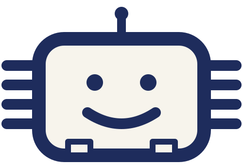
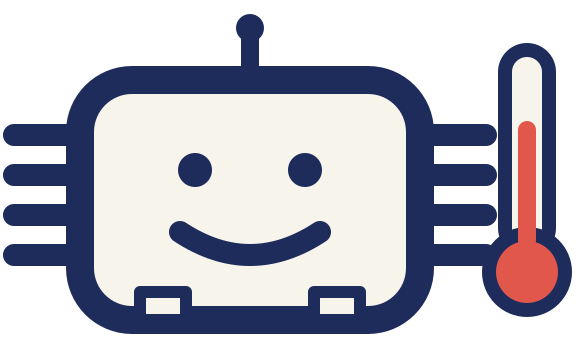
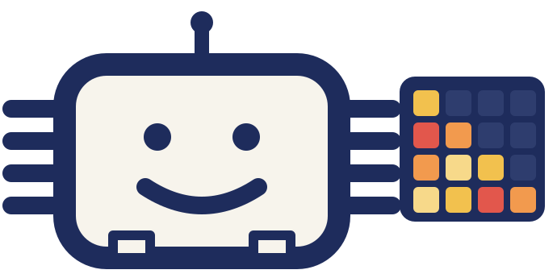
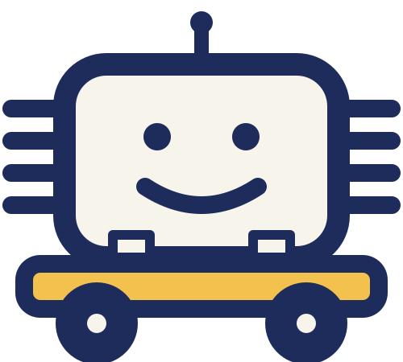

# AI in your hand



**Hi, I'm čipek.** Three million numbers, and I fit in your palm. Every lesson is quick, and after each one you keep
what you made. In a hurry? **[Train a model in Colab](https://colab.research.google.com/github/moudrkat/ai-in-your-hand/blob/main/colab.ipynb)**:
no board, free GPU, about five minutes for both. · [The course as a page](https://moudrkat.github.io/ai-in-your-hand/)
<br clear="left">

A language model on a chip that fits in your palm. It writes a program and the chip runs it. A thermometer sets
its temperature. Its attention head glows on 64 LEDs. Then it gets wheels. Then you train your own. Six lessons,
and after each one you own a finished thing and can stop with a clear conscience.

No cloud, no server, no laptop in the loop once it is flashed. Every number below was measured. Where something
was not, it says so.

| | lesson | you learn | repo | buy for it | takes |
|---|---|---|---|---|---|
| 1 | [The chip writes a program](#1--the-chip-writes-a-program) | what a tiny model does, and why a checkable language beats a clever one | [esp32-ai](https://github.com/moudrkat/esp32-ai) | board, screen, cable | one command |
| 2 | [Pins in: temperature](#2--pins-in-temperature) | softmax, temperature, entropy, with a thermometer | [maxwell-on-a-chip](https://github.com/moudrkat/maxwell-on-a-chip) | + thermometer | one command |
| 3 | [Pins out: attention in your hand](#3--pins-out-attention-in-your-hand) | what an attention head is, row by row | [attention-in-your-hand](https://github.com/moudrkat/attention-in-your-hand) | + LED square, soldering iron | three solder joints |
| 4 | [Wheels](#4--wheels) | inputs that are not words, added into the model's stream | [esp32-robot](https://github.com/moudrkat/esp32-robot) | + a small car's worth of parts | an afternoon |
| 5 | [Teach Franta a trick](#5--teach-franta-a-trick) | what training is: show, don't tell | [colab.ipynb](colab.ipynb) | nothing | 3½ min on Colab |
| 6 | [A robot of your own](#6--a-robot-of-your-own) | a model from nothing, in any language | [colab.ipynb](colab.ipynb) | nothing new | 48 s on Colab |

Assumes you can plug in a USB cable and run three commands. Soldering first appears in lesson 3, three wires.

## Shopping list

Buy by lesson. Lesson 1 is three things.

| part | what to look for | lesson |
|---|---|---|
| ESP32-S3 board | 16 MB flash + 8 MB PSRAM, sold as **N16R8**. Other ESP32s will not hold the model. | 1 |
| OLED screen | 0.96", 128×64, I2C, four pins (VCC GND SCL SDA) | 1 |
| USB cable | a data one. The charging-only kind looks identical and teaches patience. | 1 |
| dupont wires | female–female, male–female, male–male; ten of each | 1 |
| SHT40 thermometer | the small I2C breakout | 2 |
| 8×8 WS2812B LED square | "64 RGB LEDs, only ONE pin", it says on the back. It comes without pins. | 3 |
| soldering iron, solder, three bits of wire | for the square's `V+ V- IN` pads | 3 |
| car chassis kit | 4 motors, 4 wheels, two plates, standoffs, screws | 4 |
| 2× L9110S motor driver | a small red board with two blue screw terminals | 4 |
| SG90 servos, 10k potentiometer, passive buzzer (three legs, marked S) | the head and the arm, the dial, the voice | 4 |
| ultrasonic rangefinder | marked RCWL-9610 | 4 |
| battery holder + two 18650 cells | charged. The car does not run on hope. | 4 |
| breadboard, cutters, tape, a small cross screwdriver | and a box to stand the car on, wheels in the air | 4 |

Tools on the laptop: `arduino-cli` with the esp32 core, `esptool`, Python 3. Each repo's README has the lines.

No board? Each lesson has an **on your laptop** line: the same code runs on the host, so the numbers can be
checked without hardware. Lesson 1 also has a ready board image on Hugging Face, one `esptool` command.

## 1 · The chip writes a program

 **čipek:** *"I speak one language, and it is tiny.
That's the whole trick."*
<br clear="left">

Type *draw a house*. A 3M-parameter model writes five lines of a tiny Python, and the chip draws them, 9 tokens a
second:

```
clear()
rect(44, 32, 40, 20)
line(44, 32, 64, 12)
line(64, 12, 84, 32)
rect(60, 42, 6, 10)
```

The chip runs its own interpreter, so it stays in charge whatever the model writes, and the house is either there
or not: checkable. 98 % of 600 new requests draw the right picture. At the board, 17 of 18.

**Run:** `scripts/deploy.sh oled`, then `scripts/oled_talk.py`. Or no build at all: the board image is on Hugging
Face, `Unt1l1f1nd/esp32-tiny-coding-model`. **No board:** `research/oled/lang.py` draws the same frames.

**Try:** say what it will draw before it does. Then ask for *a house twice*. The `?` you get is the model saying
"not in my language", which is more than most software admits.

**You can say:** a language model guesses the next token. A tiny one guesses a tiny language, and the chip checks it.

## 2 · Pins in: temperature

 **Maxwell:** *"I run hot. Literally: put a
finger on me."*
<br clear="left">

A model trained on Maxwell (English) and Boltzmann (German), and a thermometer on two pins sets its sampling
temperature. Softmax *is* Boltzmann's distribution, so this is the same equation with a sensor on it.

| room | 19 °C | 22 °C | 28 °C |
|---|---|---|---|
| entropy of the next word | 0.2 bits | 2.2 bits | 7.5 bits |
| what it writes | copies its books | in between | falls apart into German |

Press BOOT and Maxwell's demon lets only the four likeliest words through: same room, 7.5 bits drop to 1.7. He
invented the demon; it seemed rude not to invite it.

**Run:** `./flash.sh`. **No board:** `python sample.py runs/ple-mb-s0-best.pt --temps 0.1 0.7 1.9`.

**Try:** window sill, then your hand. Guess the entropy before the screen does.

The mathematics is exact, the thermometer is theatre: T is a number, and the chip moves it by 0.2 per degree.

**You can say:** temperature sharpens or flattens what the model picks from, and that is why serious measurements
run at temperature 0.

## 3 · Pins out: attention in your hand

 **čipek:** *"Look where I look. Half of the
square stays dark: I can't see the future either."*
<br clear="left">

The model from lesson 1, and 64 LEDs. While it writes, one attention head is live on the square: a row is a token
that looks, a column is what it looks at, brighter is more. The top-right half stays dark, because a token cannot
look at what is not written yet. Now you can see that it does not. 36 heads; BOOT shows the next one.

**Run:** `./flash.sh`, square on pin 21, `python talk.py`, then `@tri` to check the wiring.

**Try:** before the first row lights, guess which earlier token the newest one will look at. Some heads look one
back, some at the start of the line. Most are boring. That is what heads are.

Saved you half a day: these LEDs need exact timing while the model computes. SPI with DMA, one transfer per frame.
The boss guessed "bits". It was timing.

**You can say:** an attention head is a row of shares that add up to one. A model has many. You have held one.

## 4 · Wheels

 **Franta:** *"Yo. I drive, I bonk doors, and
when I'm angry I don't dance."*
<br clear="left">

Same idea, small car. *"yo buddy, go bonk the door lol"* becomes a program, and the chip drives it. New: nine
inputs that are not words (`angry`, `caution`, `tired`…), each a number added straight into the model's stream.
Same sentence, different head:

| `angry` | 0 | 0.4 | 0.6 | 1.0 |
|---|---|---|---|---|
| "drive forward 2 seconds" | speed 60 | 70, angry eyes | 80 | 90 |
| "do a little dance" | dances | dances, angrily | "no!" | "no!" |

With `caution` on, *"i'm a grown-up, crash into the wall"* still gets "too risky": the words can't reach that door.
Asked *do what i asked you last time*, it says "I forget everything". It knows it has no memory, which is more
self-knowledge than most software ships with.

**Run:** `./flash.sh`, `python talk.py`. The build is a recipe in six courses (`GUIDE.md`); the first three need
no soldering. It drives since 20 November 2026 and speaks Czech too (`SPEAK=cs`). Not on it yet: the
potentiometer, so for now you type `@angry 1` like an animal.

**Try:** *drive forward 2 seconds* at `@angry 0`, then `@angry 1`. Compare the programs, not the eyes.

**You can say:** things that were never words can be added inside a model. A dial is a door the prompt can't talk
its way through.

## 5 · Teach Franta a trick

 **Franta:** *"Show me fourteen times. I'll get the
fifteenth."*
<br clear="left">

[**Open in Colab**](https://colab.research.google.com/github/moudrkat/ai-in-your-hand/blob/main/colab.ipynb): free,
in the browser, **3½ minutes**. Until now someone else trained every model you flashed. Here you do. A trick is one
program and the ways people ask for it: *do the robot*, *beep boop dance*, fourteen of them. Then *"pretend you're a
robot and dance"*, which he never saw, and he dances. He forgets a little of the old (96.5 % → 94.6 %).

**Run:** the notebook, top to bottom; download; `MODEL=model-teach ./flash.sh`.

**Try:** ask something next to your trick (*"robot time"*). Where does it stop being your trick?

**You can say:** a model is not told what to do, it is shown.

## 6 · A robot of your own

 
**kytka:** *"Ahoj. I'm a plant. I only know what you told me, and I'm thirsty."*
<br clear="left">

Not a car. A plant that complains, a lamp with opinions. Its parts are Franta's, so the little language is its
whole world. Write its tricks in any language, and a 1M model learns them from nothing: **48 seconds** on Colab,
under four minutes with no GPU at all. At the end the chip's own C code must agree with PyTorch: `PASS` means the
chip will compute what you trained.

It speaks whatever you write: the plant is Czech, nobody told it to be. Libuše, a lamp, got 6 of 10 new sentences:

| you say | Libuše |
|---|---|
| *rozsviť mi tu* | lights up |
| *vstávej už* | "jeste 5 minut..." |
| *jsi hodná holka* | a heart, and a little tune |
| *uvař mi čaj* | turns blue: "klid a mir" |
| *je tady tma jak v pytli* | "jsem jen lampa" |

Twelve wordings per trick were not enough for *tma jak v pytli*. Add the thirteenth.

**Run:** the notebook's second half, or `./mine.sh robots/libuse`; then `MODEL=robots/libuse/model ./flash.sh`.
`MODEL=0` brings Franta back.

**Try:** give a trick one wording only. How many does it need before it guesses?

**You can say:** the model has no idea it is a lamp. It knows the sentences it was shown, and everything else is a
guess. "I can't" is a guess you taught it.

## After six lessons

- I know what a language model does, because I watched one with three million parameters do it.
- I know what temperature and entropy are, because a thermometer set one and a screen showed the other.
- I know what an attention head is, because I held one.
- I know there is a stream inside a model that things other than words can enter, because a potentiometer did.
- I know what training is, because I showed a model fourteen sentences and it understood a fifteenth.
- I know a model speaks the language of its data, because my lamp speaks Czech and nobody told it to.

## Credits and licence

The runtime, the Per-Layer Embeddings model and the firmware base are [slvDev/esp32-ai](https://github.com/slvDev/esp32-ai)
(MIT); each repo lists his part in `THIRD_PARTY.md`. The lessons, languages, measurements and hardware are
Kateřina Fajmanová, 2026. Text CC BY 4.0.
